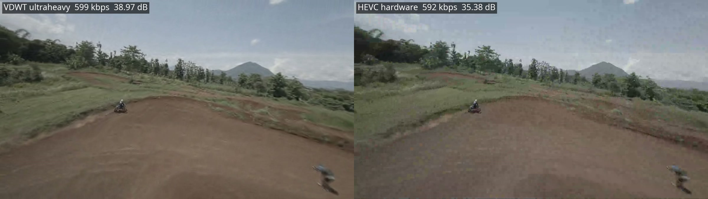
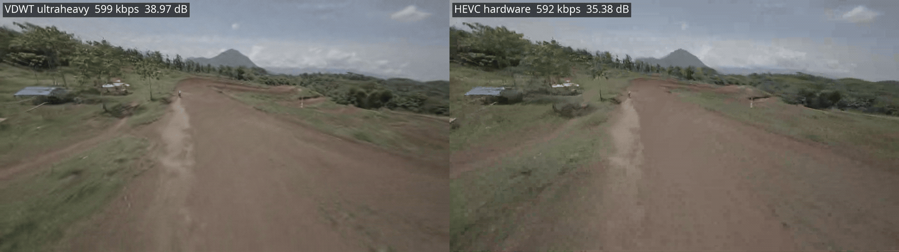
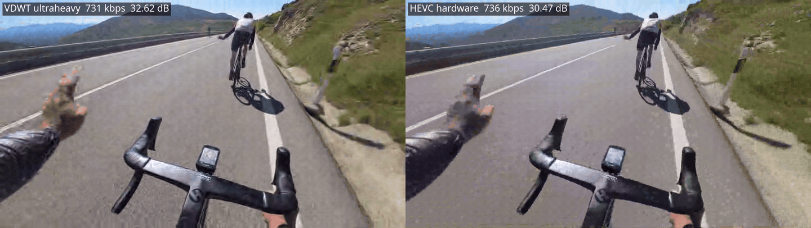

# VDWT



<sub>1080p60 FPV footage at 600 kbit/s. Left: VDWT `ultraheavy`, 38.97 dB. Right: hardware HEVC,
35.38 dB.</sub>

> **The codec is fully available for use today** as prebuilt binaries. **The source code will be
> open-sourced soon.**

VDWT is a low-latency wavelet video codec for drone downlinks, robotics and other live video on
small ARM devices. It codes whole frames with an integer wavelet transform and predicts motion
with a smooth motion mesh: there are no blocks anywhere in the pipeline, so no blocking
artifacts, and every stage runs in parallel.

> **Beta.** The bitstream format may still change between beta versions, so keep your source
> footage rather than archiving only `.vdwt` streams.

## Why VDWT

- **Better pictures at low bitrates.** At equal bitrate VDWT beats hardware HEVC by 1.4 to
  3.6 dB of YUV-PSNR on 1080p60 action footage (see [Results](#results)).
- **Reaches rates hardware HEVC cannot.** On fast 1080p60 footage a hardware HEVC encoder may
  bottom out above 700 kbit/s; VDWT holds any link rate down to a few kbit/s, sending 7-byte
  repeat frames when nothing changes.
- **Low latency and link-following rate control.** The rate can change mid-stream
  (`4M@0,1500k@40`); frames are kept within a queueing-delay bound, and when a frame cannot fit,
  its finest detail is dropped instead of the frame.
- **Runs on small ARM boards.** The realtime tier encodes 720p at about 20–50 ms per frame on
  four Cortex-A55 cores (Orange Pi 3B class), and decodes in about 24 ms.
- **Deterministic.** Streams and decoded pictures are bit-exact across x86 and ARM and do not
  depend on the thread count.
- **Loss-tolerant mode** (`rt-encode` / `rt-decode`) for lossy radio links: independent tiles in
  self-contained packets of at most one MTU.

## Download

Prebuilt binaries are attached to each [release](../../releases):

| Platform | File |
|---|---|
| Linux x86_64 (AVX2 or portable) | `vdwt-<version>-x86_64-linux.tar.gz` |
| Linux ARM64 (NEON; Raspberry Pi 4/5, Orange Pi, Jetson, …) | `vdwt-<version>-aarch64-linux.tar.gz` |

The Linux binaries are static and need no libraries. Windows and macOS builds are planned.

After unpacking, check that the binary works on your CPU:

```bash
./vdwt selftest
```

```bash
./vdwt info
```

## Quick start

Encode at a fixed quality (a higher qp is coarser; +8 doubles the quantizer step):

```bash
vdwt encode clip.mp4 clip.vdwt --qp 44
```

Encode for a link rate with the strongest tier:

```bash
vdwt encode clip.mp4 clip.vdwt --bitrate 600k --tier ultraheavy
```

Decode, or play directly:

```bash
vdwt decode clip.vdwt out.y4m
```

```bash
vdwt decode clip.vdwt - | ffplay -
```

Inputs other than `.y4m` (MP4, MKV, MOV, …) are read through `ffmpeg`, which must be installed.
The full command and option reference is in [docs/USAGE.md](docs/USAGE.md).

## Encoder tiers

| Tier | Flag | Use |
|---|---|---|
| realtime | `--realtime` | Live encoding on small ARM CPUs |
| light | `--tier light` | Fast encoding on desktop CPUs |
| medium | default | Balanced |
| heavy | `--tier heavy` | Slower, a little smaller |
| ultraheavy | `--tier ultraheavy` | Best compression: adds B-frames, about 1.5–4× heavy's time |

All tiers produce streams that the same decoder plays.

## Supported formats and limitations

| | |
|---|---|
| Coded format | 8-bit 4:2:0, any frame size and frame rate |
| Input | `.y4m` in 4:2:0, 4:2:2, 4:4:4 or monochrome at 8–16 bits (converted to 8-bit 4:2:0); `-` for Y4M on standard input; any file `ffmpeg` can read |
| Output | 8-bit 4:2:0 `.y4m`, or `-` for standard output |
| Container | raw `.vdwt` stream; no MP4/MKV mapping yet |
| Audio | none: VDWT is video only |

Not supported yet: coding at 10 bits or more, 4:2:2 or 4:4:4 without subsampling, alpha,
interlaced video, HDR metadata, and colour-range or matrix signalling.

## Results

1080p60, VDWT `ultraheavy` against hardware HEVC (Intel VAAPI `hevc_vaapi`) at the same
bitrate. Quality is YUV-PSNR 6:1:1, (6·Y + U + V) / 8, averaged over all frames.

| Clip | Bitrate | VDWT | Hardware HEVC | Difference |
|---|---|---|---|---|
| Motocross FPV drone (8 s) | 1 Mbit/s | 40.27 dB | 36.98 dB | **+3.29 dB** |
| Motocross FPV drone | 600 kbit/s | 38.97 dB | 35.38 dB | **+3.59 dB** |
| Bike, first-person ride (10 s) | 1 Mbit/s | 33.23 dB | 31.81 dB | **+1.42 dB** |
| Bike | 731 kbit/s | 32.62 dB | 30.47 dB | **+2.15 dB** |

At 600 kbit/s the hardware encoder could not go below about 730 kbit/s on the bike clip, so
that row compares both at 731 kbit/s.

**Motocross FPV drone, 600 kbit/s** (left VDWT, right hardware HEVC):



**Bike, 731 kbit/s, equal bitrate** (left VDWT, right hardware HEVC):



The GIFs are 3-second excerpts at 25 fps; the full-length 60 fps side-by-side videos are attached
to the release.
Benchmarks against software encoders (x265) on public test sequences will follow.

Footage: [Motocross FPV drone](https://www.pexels.com/video/motocross-fpv-drone-18326007/) by
Eno Eltora and [Bike](https://www.pexels.com/video/bike-26956379/) by Adrián Vizuete Moreno, both
from Pexels.

## License

VDWT is free to use for personal, research and educational use and for small businesses; larger
commercial use needs a commercial license. The exact terms will be published with the first
release. The source code will be open-sourced soon.

## Feedback

Bug reports and results on your own footage are welcome in the
[issues](../../issues). Please include the command line, the `vdwt info` output and, if you can,
a short clip that shows the problem.
