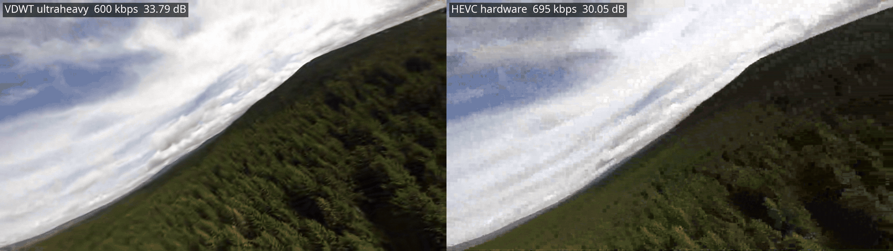
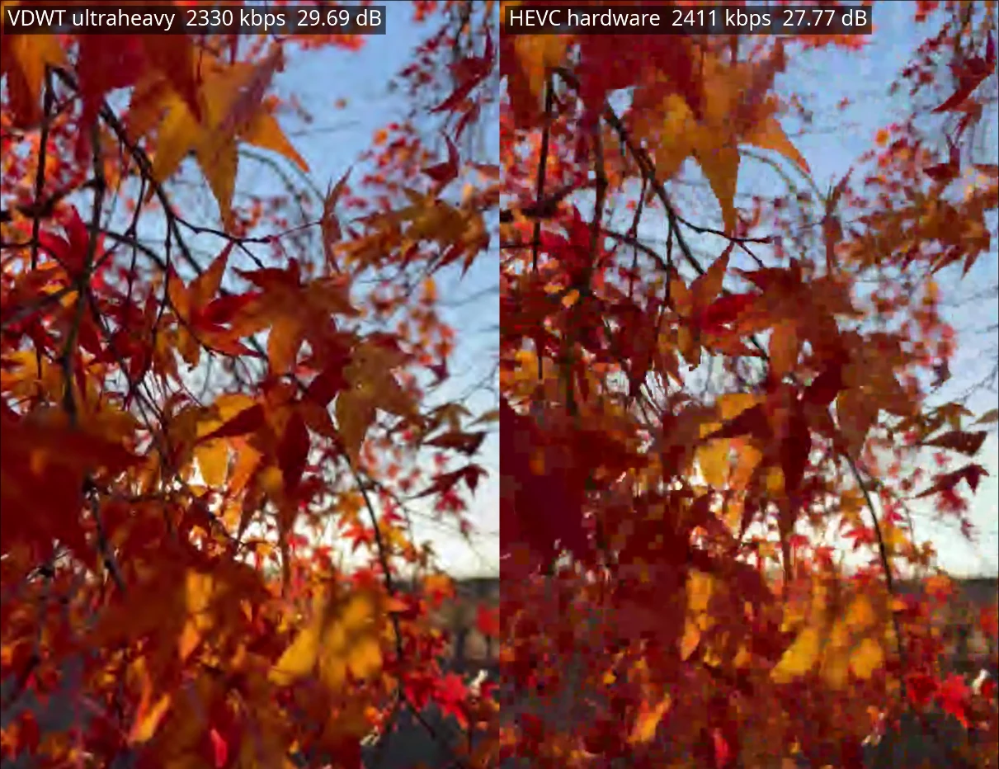
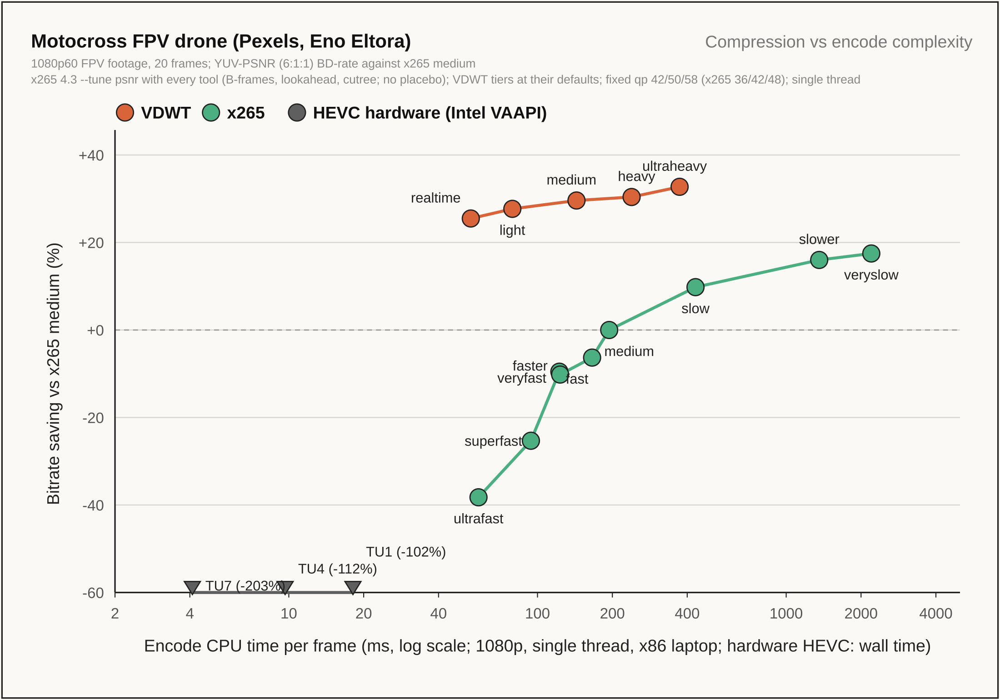
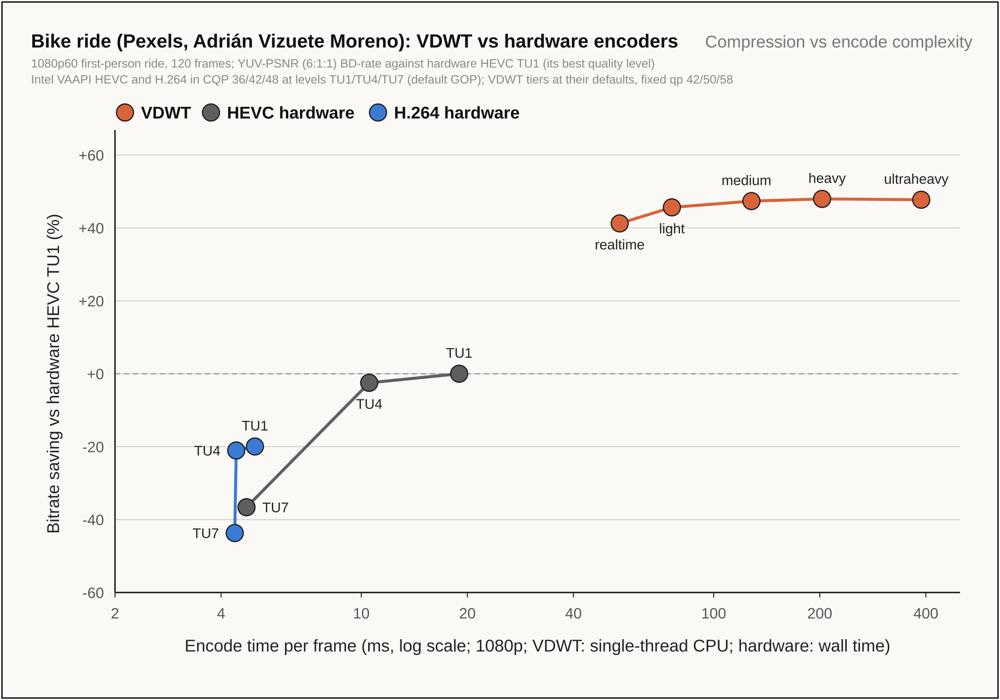

# VDWT

## Forest FPV drone  1080p60  600 kbit/s

**Left: VDWT `ultraheavy` 600 kbit/s, 33.79 dB  Right: hardware HEVC 695 kbit/s, 30.05 dB**



## Autumn foliage · 1080×1920 30 fps · 2.3 Mbit/s (equal bitrate)

**Left: VDWT `ultraheavy` 2330 kbit/s, 29.69 dB  Right: hardware HEVC 2411 kbit/s, 27.77 dB**



The lowest rate the hardware HEVC encoder reaches on this clip is about 2.3 Mbit/s.

## Compression against encode speed

Every VDWT tier against every x265 preset (`--tune psnr`, all tools on, no placebo) and the three
hardware HEVC speed levels, as bitrate saving relative to x265 `medium` (higher is better) over
encode time per frame. Hardware HEVC needs 2× to 3× x265 medium's bits here, so its points sit
below the chart edge with their values.



### Against the GPU's hardware encoders

At the same quality, VDWT needs **63 to 67% fewer bits than hardware HEVC** on the motocross
clip (realtime to ultraheavy, against the encoder's best level, TU1).

On a longer run of the bike ride (120 frames), VDWT against Intel's hardware HEVC and H.264:



| VDWT tier | Fewer bits than hardware HEVC (TU1) | Fewer bits than hardware H.264 (TU1) |
|---|---|---|
| realtime | 41% | 50% |
| light | 46% | 54% |
| medium | 47% | 56% |
| heavy | 48% | 56% |
| ultraheavy | 48% | 56% |

Hardware encoders are faster per frame (5 to 19 ms against VDWT's 54 ms single-thread for
`realtime` at 1080p), but the bits they need are the cost a link pays on every frame.

VDWT is a **hardware-aware, fully parallel video codec** built to compete with
hardware-accelerated codecs such as HEVC, and to beat them on efficiency. It is designed from
the ground up to run fast on small CPUs and to map directly onto GPUs, NPUs, FPGAs and ASICs,
for live video where every bit and every millisecond counts: drone downlinks, robotics and
embedded cameras.

Under the hood it is a block-free wavelet codec: an integer wavelet transform for whole frames
and a smooth motion mesh for prediction, so there are no blocking artifacts and every stage runs
in parallel.

Its strength is motion: on fast drone, FPV and action footage it needs far fewer bits than
HEVC. Static content, such as talking heads, studio shots and screen-like scenes, is harder for a
whole-frame wavelet, because sharp edges and fine text cost more to code without block-based intra
prediction. VDWT closes much of that gap with tools built for still scenes: hierarchical B-frame
groups when the camera is still, motion snapped to exactly zero for a locked-off camera, and
identical frames sent as tiny Repeat frames. Even on static content its `ultraheavy` tier still
needs fewer bits than hardware HEVC at the same quality.

The bitstream format is not frozen yet, so a stream from one version may not decode with the next.

## Why VDWT

- **Better pictures at low bitrates.** At equal bitrate VDWT beats hardware HEVC by 1.4 to
  3.6 dB of YUV-PSNR on 1080p60 action footage (see [Results](#results)).
- **Reaches rates hardware HEVC cannot.** On fast 1080p60 footage a hardware HEVC encoder may
  bottom out above 700 kbit/s; VDWT holds any link rate down to a few kbit/s, sending 7-byte
  repeat frames when nothing changes.
- **Strongest where video is hardest.** VDWT does extremely well on high-motion, complex footage
  (FPV flights, action, fast pans, dense texture), and still does a solid job on low-motion
  content such as podcasts and talking heads.
- **Low latency and link-following rate control.** The rate can change mid-stream
  (`4M@0,1500k@40`); frames are kept within a queueing-delay bound, and when a frame cannot fit,
  its finest detail is dropped instead of the frame.
- **Runs on small ARM boards.** The realtime tier encodes 720p at about 20–50 ms per frame on
  four Cortex-A55 cores (Orange Pi 3B class), and decodes in about 24 ms.
- **Deterministic.** Streams and decoded pictures are bit-exact across x86 and ARM and do not
  depend on the thread count.
- **Loss-tolerant mode** (`rt-encode` / `rt-decode`) for lossy radio links: independent tiles in
  self-contained packets of at most one MTU.

## Download

Prebuilt binaries are attached to each [release](../../releases):

| Platform | File |
|---|---|
| Linux x86_64 (AVX2 or portable) | `vdwt-<version>-x86_64-linux.tar.gz` |
| Linux ARM64 (NEON; Raspberry Pi 4/5, Orange Pi, Jetson, …) | `vdwt-<version>-aarch64-linux.tar.gz` |
| Windows 10/11 x86_64 (AVX2 or portable) | `vdwt-<version>-x86_64-windows.zip` |

The binaries need no extra libraries. Streams and decoded pictures are identical on every
platform. macOS builds are planned.

### Build from source

Rust 1.87 or newer; no other dependencies.

```bash
cargo build --release
```

```bash
cargo test --release
```

The binary is `target/release/vdwt`. For a static ARM64 binary (no cross C toolchain needed):

```bash
rustup target add aarch64-unknown-linux-musl
```

```bash
cargo build --release --target aarch64-unknown-linux-musl -p vdwt-cli
```

The design is described in [DESIGN.md](DESIGN.md).

### Check the binary

After unpacking or building, check that the binary works on your CPU:

```bash
./vdwt selftest
```

```bash
./vdwt info
```

## Quick start

Encode at a fixed quality (a higher qp is coarser; +8 doubles the quantizer step):

```bash
vdwt encode clip.mp4 clip.vdwt --qp 44
```

Encode for a link rate with the strongest tier:

```bash
vdwt encode clip.mp4 clip.vdwt --bitrate 600k --tier ultraheavy
```

Decode, or play directly:

```bash
vdwt decode clip.vdwt out.y4m
```

```bash
vdwt decode clip.vdwt - | ffplay -
```

Inputs other than `.y4m` (MP4, MKV, MOV, …) are read through `ffmpeg`, which must be installed.
The full command and option reference is in [docs/USAGE.md](docs/USAGE.md).

## Encoder tiers

| Tier | Flag | Use |
|---|---|---|
| realtime | `--realtime` | Live encoding on small ARM CPUs |
| light | `--tier light` | Fast encoding on desktop CPUs |
| medium | default | Balanced |
| heavy | `--tier heavy` | Slower, a little smaller |
| ultraheavy | `--tier ultraheavy` | Best compression: adds B-frames, about 1.5–4× heavy's time |

All tiers produce streams that the same decoder plays.

## Supported formats and limitations

| | |
|---|---|
| Coded format | 8-bit 4:2:0, any frame size and frame rate |
| Input | `.y4m` in 4:2:0, 4:2:2, 4:4:4 or monochrome at 8–16 bits (converted to 8-bit 4:2:0); `-` for Y4M on standard input; any file `ffmpeg` can read |
| Output | 8-bit 4:2:0 `.y4m`, or `-` for standard output |
| Container | raw `.vdwt` stream; no MP4/MKV mapping yet |
| Audio | none: VDWT is video only |

Not supported yet: coding at 10 bits or more, 4:2:2 or 4:4:4 without subsampling, alpha,
interlaced video, HDR metadata, and colour-range or matrix signalling.

## Results

1080p60, VDWT `ultraheavy` against hardware HEVC (Intel VAAPI `hevc_vaapi`) at the same
bitrate. Quality is YUV-PSNR 6:1:1, (6·Y + U + V) / 8, averaged over all frames.

| Clip | Bitrate | VDWT | Hardware HEVC | Difference |
|---|---|---|---|---|
| Forest FPV drone (8 s) | 600 kbit/s (HEVC 695) | 33.79 dB | 30.05 dB | **+3.74 dB** |
| Motocross FPV drone (8 s) | 1 Mbit/s | 40.27 dB | 36.98 dB | **+3.29 dB** |
| Motocross FPV drone | 600 kbit/s | 38.97 dB | 35.38 dB | **+3.59 dB** |
| Autumn foliage, 1080×1920 30 fps (6.5 s) | 2.3 Mbit/s | 29.69 dB | 27.77 dB | **+1.92 dB** |
| Bike, first-person ride (10 s) | 1 Mbit/s | 33.23 dB | 31.81 dB | **+1.42 dB** |
| Bike | 731 kbit/s | 32.62 dB | 30.47 dB | **+2.15 dB** |

At 600 kbit/s the hardware encoder could not go below about 730 kbit/s on the bike clip, so
that row compares both at 731 kbit/s; on the forest clip its lowest rate was 695 kbit/s, so
HEVC has 16% more bits than VDWT in that row. The forest clip is the last 16 s of the source
played at 2× speed. The forest GIF at the top is a 3-second excerpt at 25 fps and the
autumn image is a single frame; the full-length side-by-side videos are attached to the release.
Benchmarks against software encoders (x265) on public test sequences will follow.

Footage: [Motocross FPV drone](https://www.pexels.com/video/motocross-fpv-drone-18326007/) by
Eno Eltora, [Bike](https://www.pexels.com/video/bike-26956379/) by Adrián Vizuete Moreno,
[Forest drone](https://www.pexels.com/video/dynamic-drone-footage-of-forest-path-at-high-speed-30324643/)
by Lukáš Vaňátko and
[Autumn foliage](https://www.pexels.com/video/vibrant-autumn-foliage-swaying-in-the-breeze-35279102/)
by Marcio Sonoda, all from Pexels.

## License

VDWT is available under your choice of:

- the [GNU AGPL-3.0](LICENSE-AGPL-3.0.txt), free for everyone who meets its terms (if you
  distribute VDWT or software built with it, or offer it over a network, you share that
  software's source under the AGPL);
- the [PolyForm Small Business License 1.0.0](LICENSE-PolyForm-Small-Business-1.0.0.md), free for
  companies with fewer than 100 people and under 1M USD revenue, including in closed-source
  products;
- a [commercial license](COMMERCIAL.md) for everyone else who wants to ship VDWT without the
  AGPL's obligations.

See [LICENSE](LICENSE). **Commercial licensing:** [vdwt@proton.me](mailto:vdwt@proton.me)

## Contributing

Bug reports, benchmarks on your own footage and pull requests are welcome. To keep the
small-business and commercial licenses possible, contributions are accepted under a
Contributor License Agreement; see [CONTRIBUTING.md](CONTRIBUTING.md).

## Feedback

Bug reports and results on your own footage are welcome in the
[issues](../../issues). Please include the command line, the `vdwt info` output and, if you can,
a short clip that shows the problem.

> [!IMPORTANT]
> **VDWT is open source.** Use it under the AGPL-3.0, free for small businesses under the PolyForm
> Small Business License, or under a commercial license. Prebuilt binaries are in the
> [releases](../../releases).
